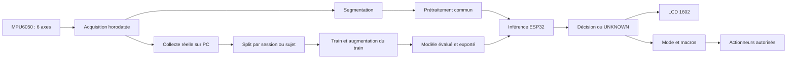

# Architecture proposée — évolution par phases

Ce plan décrit la destination du dépôt, pas des modules déjà implémentés.
Seuls le firmware de banc, sa configuration, le vérificateur série, les tests
de protocole et la documentation sont créés à ce stade.

```text
GestureOS AI/
  .agent/                       état, prochaine action, checkpoint, décisions
  firmware/
    platformio.ini
    include/config.h
    src/
      main.cpp                  orchestration
      imu.*                     acquisition, diagnostics, puis calibration
      gesture_engine.*          segmentation et fenêtre temporelle
      model.*                   interface d'inférence et rejet
      lcd_ui.*                  écran logique 2 × 16, unique accès au LCD
      menu.*                    navigation sans dépendance au modèle
      modes.*                   geste accepté → action selon mode
      macro_engine.*            séquences, timeout, annulation
      actuators/                servo, LED, buzzer ; drivers conditionnels
  src/gestureos/                futur package Python réutilisable
    protocol.py                 contrat acquisition et métadonnées
    preprocessing.py            transformations identiques PC/ESP32
    features.py                 baseline explicable
    split.py                    groupes session/sujet et filiation
    augmentation.py             train seulement
    rejection.py                calibration validation, jamais test final
  scripts/
    check_stream.py             présent : vérification de banc uniquement
    capture_serial.py           futur logger labellisé, protocole versionné
    preprocess.py
    train.py
    evaluate.py
    export_tflite.py
    test_realtime.py
  configs/                      labels, pipeline, expérimentation
  data/{raw,processed,augmented,external}/
  experiments/<id>/             config, hash de split, modèle, métriques
  models/{sklearn,keras,tflite}/
  reports/{hardware,ml}/
  notebooks/                    explorations, pas source unique du pipeline
  tests/
  docs/
  outputs/                      guides et livrables lisibles
```



Les décisions ML ne commandent pas directement les broches. Un événement de
geste comprend label, score, marge, timestamps et état de rejet. UNKNOWN ne
déclenche aucune action. Les actions ont des limites, délais et possibilités
d'arrêt indépendants du modèle. `X` peut être une commande de démo mais ne doit
pas être le seul moyen d'arrêt d'un mécanisme.

Le mode PRESENTATION expose d'abord une interface d'action. Son transport HID
restera désactivé jusqu'à validation de la bibliothèque, de la carte, de l'OS
hôte et des reconnexions. Bluetooth présent sur la puce ne signifie pas que
l'application HID est déjà implémentée ou testée.

Pour le LCD parallèle, la phase 3 vérifiera son contrôleur et ses niveaux
logiques, puis utilisera une interface 4 bits avec R/W relié à GND. Le brochage
GPIO complet n'est pas figé avant l'inventaire des boutons et actionneurs.
Ne pas acheter un adaptateur I2C pour contourner cette étape.

Le pipeline IA débutera par six gestes (directions, cercle horaire, shake),
puis baselines RF/SVM/MLP. Les normalisations seront ajustées sur le train
seulement. Les augmentations porteront l'identifiant du sample parent et seront
générées après le split. La validation choisira hyperparamètres et seuils de
rejet ; le test final réel restera intact. Les scores UNKNOWN incluront taux
de faux acceptés, vrais connus rejetés et faux déclenchements par minute.

La consommation TinyML sera mesurée avec le modèle réellement retenu : Flash,
RAM statique, heap/stack, arène de tenseurs et latence. Les chiffres de
compilation du test de banc ne permettent pas de prédire ces mesures.
